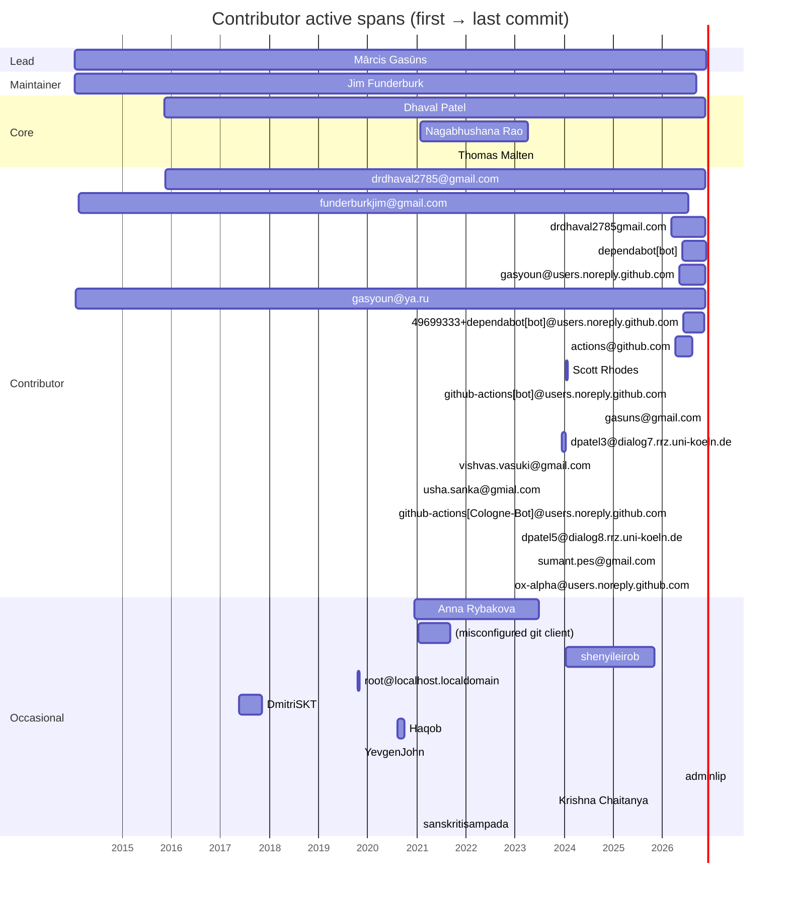

# Activity timeline

## Contributor active spans

Each bar shows a contributor's first to last commit across the ecosystem.

## Commits per year

| Year | Commits |
|---|---:|
| 2014 | 125 |
| 2015 | 419 |
| 2016 | 397 |
| 2017 | 276 |
| 2018 | 152 |
| 2019 | 417 |
| 2020 | 631 |
| 2021 | 1,705 |
| 2022 | 707 |
| 2023 | 580 |
| 2024 | 620 |
| 2025 | 873 |
| 2026 | 8,254 |

